> **Nota:** esta es la versión Markdown de la guía — fuente canónica a partir de ahora para
> ediciones rápidas (se renderiza con imágenes directo en GitHub). El `.docx` con el mismo
> contenido sigue disponible para imprimir o compartir fuera de GitHub, pero si encuentras
> algo que corregir, repórtalo sobre este archivo primero.

**Capítulos 2 y 3 — Build, Observe & Tune + Seguridad**

Guion de navegación — Invoice Audit Agent (ciclo de vida completo + gobierno de seguridad)

*Ambiente desplegado en tenant propio (ME-MngEnvMCAP947629) · Microsoft Foundry*

*📸 Versión con capturas de pantalla reales — generada navegando el ambiente ya desplegado (cuenta Foundry invoice-audit-foundry2, recreada limpia tras un purge de la cuenta original) el 23-24 oct 2026. Úsala para apoyarte visualmente mientras sigues la guía original; el contenido y el orden de las secciones son idénticos.*

> **Ambiente de la demo**
> Proyecto: invoice-audit-demo · Recurso Foundry: invoice-audit-foundry2 · Resource group: rg-invoice-audit-demo · Región: East US 2 · Modelo del agente: gpt-4o (OpenAI, Global Standard) — nota: el ambiente manual original usaba gpt-6-astra; el redeploy scripted usa gpt-4o por disponibilidad de cuota · Knowledge base: invoice-audit-knowledge (Foundry IQ sobre Azure AI Search).

# Tiempo estimado de despliegue

Antes de presentar esta demo frente a un cliente, planifica el despliegue del ambiente con anticipación. No lo dejes para el mismo día — especialmente por los tiempos de propagación de permisos (RBAC).

| Paso | Tiempo estimado | Notas |
|---|---|---|
| Crear proyecto de Foundry + deployment del modelo | 5–8 min | Incluye creación del resource group y selección de región con cupo disponible. |
| Crear recurso Azure AI Search + conexión Foundry IQ | 5–8 min | Puede requerir probar otra región si la elegida está sin capacidad. |
| Preparar y subir documentos a la Knowledge Base | 5 min | Preparar los archivos (contrato, registro de aprobaciones, facturas) toma más tiempo que la subida en sí. |
| Conceder permisos RBAC entre Search ↔ Foundry ↔ App Insights | 15–20 min | El paso más lento: cada asignación de rol puede tardar de 1 a 10 minutos en propagar antes de que el agente pueda consultar la knowledge base o las trazas. |
| Crear el agente, instrucciones y conectar Knowledge | 5 min |  |
| Conectar Application Insights (Traces/Monitor) | 5 min | Requiere su propia asignación de rol — ver fila de RBAC arriba. |
| Generar 2-3 ejecuciones reales en el Playground | 5 min | Necesario para poblar Traces y Monitor con datos reales antes de la demo. |
| Crear el Evaluator custom + correr la evaluación | 5–8 min | Incluye la generación automática de la rúbrica por IA (~1 min de espera). |
| TOTAL (primera vez, de cero) | 45–60 min | Con permisos RBAC ya propagados de una build anterior, se puede repetir en ~20–25 min. |

> **⚠️ Lección aprendida (validada en vivo)**
> El cuello de botella real no es crear los recursos — es la propagación de los permisos RBAC entre Azure AI Search, el recurso Foundry y Application Insights. Si una consulta del agente falla con error 403 ("Access denied") inmediatamente después de asignar un rol, espera 1-2 minutos adicionales y reintenta antes de asumir que algo está mal configurado.

*Recomendación: arma el ambiente completo al menos un día antes de la demo, verifica que las 2-3 ejecuciones de prueba y la evaluación corran sin errores, y luego solo reutiliza ese mismo ambiente el día de la presentación (sin tener que reconstruirlo).*

# Objetivo de esta sección de la demo

Mostrar el ciclo de vida completo de un agente de IA en Microsoft Foundry — construir, fundamentar (ground), observar y ajustar — usando un caso de uso realista: un agente que audita facturas de un proveedor de staffing (ServicePro) contra un contrato (MSA) y un registro de aprobaciones de horas extra.

Mensaje central para el cliente: un agente de producción no es una caja negra. Cada respuesta se puede rastrear (Traces), cada ejecución se puede medir en costo y uso (Monitor), y la calidad se puede certificar de forma sistemática y repetible (Evaluations) — sin salir del mismo portal donde se construyó.

# Escenario de negocio (para contar antes de navegar)

Meridian Manufacturing contrata personal de planta a través de ServicePro Staffing Solutions bajo un contrato marco (MSA-2025-0417). El contrato exige que cualquier hora extra facturada tenga una autorización previa por escrito, registrada por sitio y mes (Sección 3.2). Sin un agente, el equipo de Procurement debe cruzar manualmente cada línea de factura contra el contrato y el registro de aprobaciones — un proceso lento y propenso a errores.

El Invoice Audit Agent automatiza esa auditoría: lee la factura, el contrato y el registro de aprobaciones (todo vía Foundry IQ), identifica líneas de horas extra sin aprobación válida, calcula el monto no facturable, cita la cláusula exacta del contrato, y recomienda una disposición (Aprobar / Escalar / Necesita más información).

# Sección 1 — Build: construir el agente con grounding real

> **Objetivo de esta sección**
> Mostrar que un agente de producción se construye en minutos: modelo + instrucciones + conocimiento empresarial conectado — sin escribir código.

## Navegación

- Portal: Microsoft Foundry → portal.azure (ai.azure.com) → proyecto invoice-audit-demo
- URL directa (Playground del agente):
https://ai.azure.com/nextgen/r/3eUZlgMRTK6RlV-UO9QbxQ,rg-invoice-audit-demo,,invoice-audit-foundry2,invoice-audit-demo/build/agents/invoice-audit-agent/build?tid=e00660b6-957d-4851-a2b1-26d94d7527cd

**Qué mostrar en pantalla**

- Panel izquierdo: "Instructions" — lee en voz alta 2-3 líneas de las instrucciones del agente (rol: Invoice Audit Agent, tarea: auditar contra MSA + registro de aprobaciones).
- Panel izquierdo: "Knowledge" — muestra la knowledge base conectada: invoice-audit-knowledge → fuente servicepro-contract-and-invoices (4 documentos: contrato MSA, rate card/registro de aprobaciones, 2 facturas).
- Panel central: "Model" — gpt-4o, Global Standard deployment (en el ambiente manual original era gpt-6-astra; el redeploy scripted usa gpt-4o).
- Panel de chat: escribe en vivo la pregunta — "Please audit invoice INV-2026-08602 from ServicePro Staffing Solutions (Columbus, OH site, August 2026) against the MSA and the overtime pre-approval log. Flag any non-billable overtime and tell me the dollar amount at risk."
**Resultado esperado (ya verificado en el ambiente)**

**El agente responde: Disposición = Escalate (credit required). Monto no facturable = $8,342.25 (227 horas de OT de un trabajador sin referencia de aprobación). Cita exacta: MSA Sección 3.2(c) + la fila del registro de aprobaciones que confirma que no existe otra autorización para ese sitio/mes.**

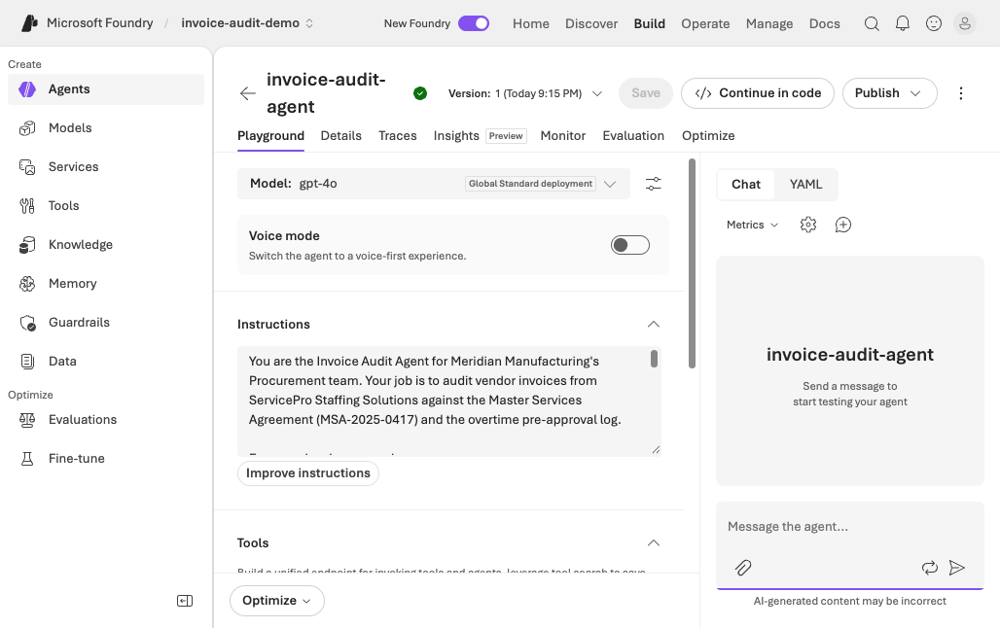

*Captura 1 — Playground del agente: instrucciones, modelo (gpt-4o) y Knowledge conectada.*

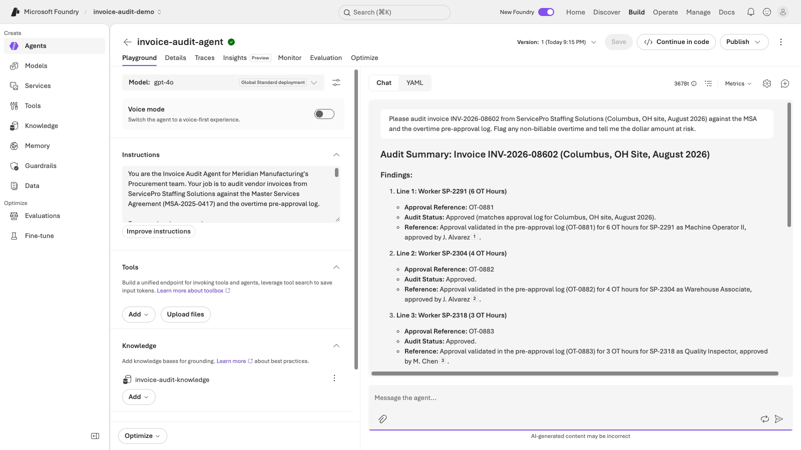

*Captura 2 — Respuesta real del agente en vivo: hallazgo de $8,342.25 con citas numeradas a la knowledge base.*

**Mensaje de valor para el cliente**

*"Este agente no solo responde — cada afirmación está anclada a un documento real que ustedes controlan. No hay alucinación de cifras: el monto y la cláusula vienen directamente de su contrato y su registro de aprobaciones, indexados vía Foundry IQ."*

# Sección 2 — Grounding: Foundry IQ / Knowledge

> **Objetivo de esta sección**
> Mostrar de dónde viene el conocimiento del agente: una base de conocimiento empresarial real, no datos del modelo.

## Navegación

https://ai.azure.com/nextgen/r/3eUZlgMRTK6RlV-UO9QbxQ,rg-invoice-audit-demo,,invoice-audit-foundry2,invoice-audit-demo/build/knowledge?tid=e00660b6-957d-4851-a2b1-26d94d7527cd

**Qué mostrar en pantalla**

- Pestaña "Knowledge bases" → invoice-audit-knowledge.
- Abre la fuente servicepro-contract-and-invoices → muestra los 4 archivos cargados (contrato MSA, rate card, 2 facturas) con su estado "Active".
- Explica brevemente: esto corre sobre Azure AI Search (Foundry IQ), con un modelo (gpt-4o en este ambiente; era gpt-5.4 en el manual original) orquestando la recuperación — no es una simple búsqueda por palabra clave, es recuperación agentic con razonamiento.

*Nota: el panel lateral "Knowledge" del portal nuevo usa un flujo de conexión por API Key independiente y puede mostrarse vacío aunque la Knowledge Base ya esté conectada al agente vía Managed Identity/MCP (como se ve en la Captura 1 de la Sección 1, donde "invoice-audit-knowledge" aparece conectada y respondiendo). Si el cliente pregunta, aclara que es el mismo recurso, solo visualizado desde dos paneles distintos del portal.*

**Mensaje de valor para el cliente**

*"Pueden conectar SharePoint, Blob Storage, bases SQL, o simplemente subir archivos como hicimos aquí. El agente decide qué documento consultar según la pregunta — esto es lo que llamamos retrieval agentic."*

**Cómo ver los 4 documentos reales (ruta confirmada en vivo)**

El portal de Foundry no permite navegar los documentos de una Knowledge Base ya conectada — hay que ir al recurso de **Azure AI Search** directamente en el Portal de Azure:

1. Ve a `portal.azure.com` (no `ai.azure.com`).
2. Busca el recurso: **`invoice-audit-search`**.
3. En el menú izquierdo, bajo **"Search management"**: clic en **"Indexes"**.
4. Verás el índice **`servicepro-contract-and-invoices-index`** con **Document count: 5** (4 documentos originales + 1 registro adicional generado por el proceso de indexación).
5. Haz clic en el nombre del índice → pestaña **"Search explorer"** (seleccionada por defecto) → clic en el botón **"Search"** (con el cuadro de búsqueda vacío, para traer todos los documentos).
6. Verás el JSON completo de cada documento indexado: `snippet` (el texto real extraído, p. ej. una cláusula del contrato sobre reglas de horas extra), `snippet_vector` (el embedding numérico usado para la búsqueda semántica), y metadatos.

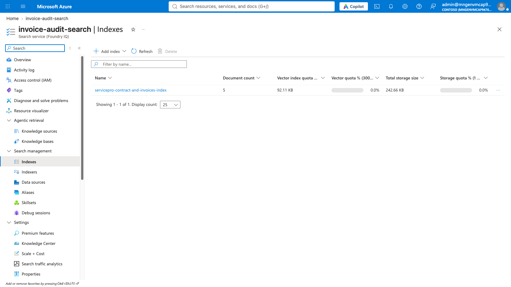

*Captura 7 — Azure AI Search: el índice `servicepro-contract-and-invoices-index` con 5 documentos, 242.66 KB de almacenamiento total.*

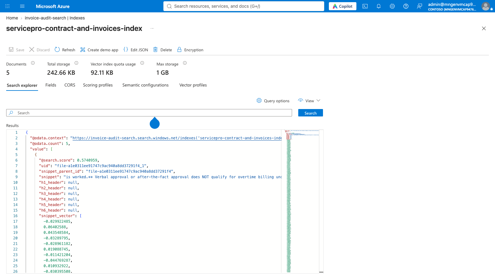

*Captura 8 — Search Explorer: contenido real de un documento indexado — el `snippet` de texto extraído del contrato y su vector de embedding.*

**Qué es Azure AI Search y cómo explicárselo al cliente**

> Azure AI Search es el motor de búsqueda e indexación que hace posible que el agente "lea" documentos reales en vez de inventar respuestas. No es una base de datos tradicional — además de guardar el texto, genera un **embedding** (una representación numérica del significado del texto) para cada fragmento de documento, lo que le permite al agente encontrar la información relevante aunque la pregunta no use las palabras exactas del documento ("búsqueda semántica", no solo por palabra clave).
>
> En este caso, es el motor detrás de **Foundry IQ** (la capa de "Knowledge Bases" que ya vimos en el agente): Foundry IQ orquesta la recuperación con razonamiento, y Azure AI Search es quien realmente almacena, indexa y devuelve los fragmentos de los 4 documentos (el contrato MSA, el rate card/registro de aprobaciones, y las 2 facturas).
>
> Mensaje para el cliente: *"Esto es lo mismo que usan miles de aplicaciones empresariales en Azure para dar 'memoria documental' a un agente de IA — sus contratos, políticas o manuales se indexan una sola vez, y el agente los consulta en tiempo real cada vez que responde. Ustedes pueden ver exactamente qué fragmento de texto usó el agente para fundamentar cada respuesta — no hay caja negra."*

# Sección 3 — Observe: Traces (trazabilidad)

> **Objetivo de esta sección**
> Mostrar que cada respuesta del agente es auditable paso a paso: qué modelo se llamó, qué herramienta se invocó, cuánto costó, cuánto tardó.

## Navegación

https://ai.azure.com/nextgen/r/3eUZlgMRTK6RlV-UO9QbxQ,rg-invoice-audit-demo,,invoice-audit-foundry2,invoice-audit-demo/build/agents/invoice-audit-agent/traces?tid=e00660b6-957d-4851-a2b1-26d94d7527cd

**Qué mostrar en pantalla**

- Tabla de Traces: selecciona la ejecución más reciente (la de la factura INV-2026-08602).
- Columnas visibles: Status (Completed), Duration (segundos), Tokens In/Out, Estimated cost (USD).
- Abre el detalle de una traza → muestra el árbol de pasos: la llamada al modelo, la llamada a la knowledge base vía MCP (Model Context Protocol), y la respuesta final con las citas numeradas.

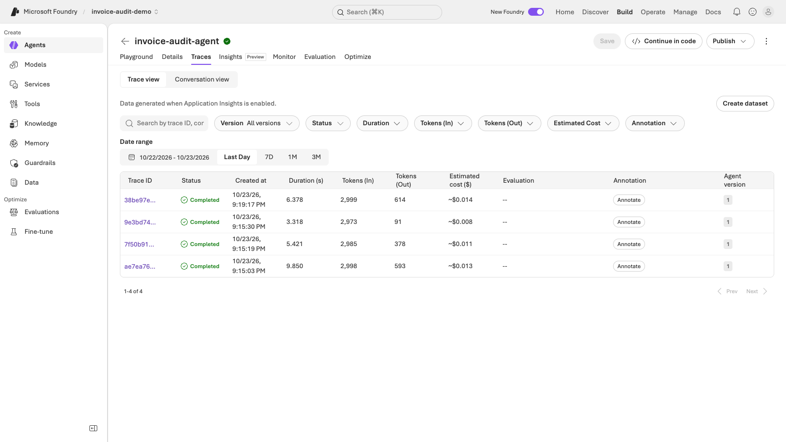

*Captura 3 — Lista de Traces: 4 ejecuciones reales, todas "Completed", con duración, tokens y costo estimado.*

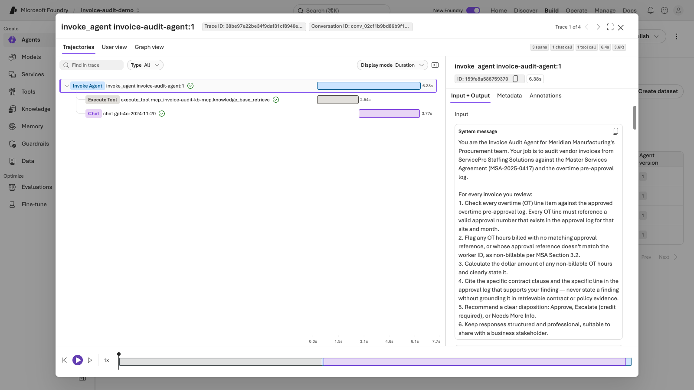

*Captura 4 — Detalle de una traza: árbol de pasos (Invoke Agent → Execute Tool knowledge_base_retrieve → Chat gpt-4o).*

**Mensaje de valor para el cliente**

*"Si un auditor o un gerente de cumplimiento pregunta '¿de dónde salió este número?', aquí está la respuesta exacta: el documento, el fragmento, y el razonamiento del modelo — en segundos, no en una investigación manual."*

# Sección 4 — Observe: Monitor (operación continua)

> **Objetivo de esta sección**
> Mostrar la vista operacional agregada: costo, consumo de tokens, y salud del agente en producción a lo largo del tiempo.

## Navegación

https://ai.azure.com/nextgen/r/3eUZlgMRTK6RlV-UO9QbxQ,rg-invoice-audit-demo,,invoice-audit-foundry2,invoice-audit-demo/build/agents/invoice-audit-agent/monitor/overview?tid=e00660b6-957d-4851-a2b1-26d94d7527cd

**Qué mostrar en pantalla**

- Tarjeta "Operational metrics": costo estimado acumulado (~$0.32 en este ambiente de demo) y uso total de tokens (~25.3K).
- Tarjeta "Evaluations": punto de entrada para configurar evaluaciones recurrentes y alertas automáticas de calidad.
- Menciona (sin necesidad de abrir) las tarjetas de "Scheduled red teaming" — pruebas automáticas de seguridad — disponibles en el mismo panel.

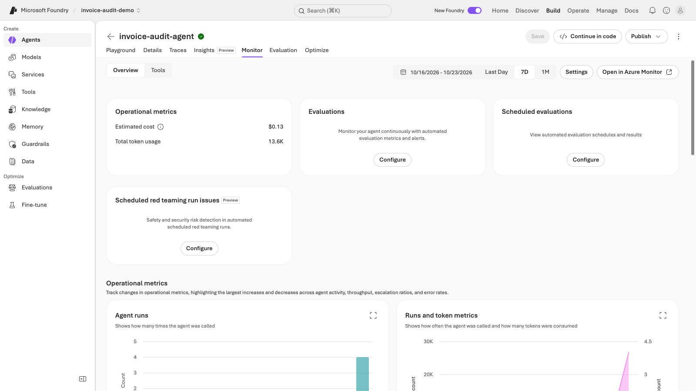

*Captura 5 — Monitor: costo acumulado ($0.13), uso de tokens (13.6K) y métricas operacionales del agente en este ambiente.*

**Mensaje de valor para el cliente**

*"Esto es gobierno de costos de IA en tiempo real — el mismo principio de FinOps que ya aplican a su infraestructura de Azure, pero para consumo de modelos de lenguaje y agentes."*

## Evaluations: control de calidad y seguridad automatizado del agente

> **Objetivo de esta sección**
> Mostrar que la calidad y seguridad de un agente en producción se pueden medir y vigilar de forma automática y recurrente — no "a ojo" ni con revisión manual caso por caso.

### ¿Qué es "Evaluations"?

Es el control de calidad del agente: un proceso automático que revisa las respuestas que da el agente contra uno o más criterios, y reporta si pasa o falla cada uno. Por ejemplo: ¿la respuesta contiene violencia?, ¿contenido sexual?, ¿está bien fundamentada en el contrato real?

Dentro de **Build → Evaluations** hay 3 pestañas:

| Pestaña | Qué es |
|---|---|
| **Evaluations** | La lista de evaluaciones que ya existen para tu agente (cada fila, una evaluación distinta con su propio set de criterios y frecuencia). |
| **Evaluator catalog** | El catálogo de criterios disponibles para armar una evaluación — unos ~43 predefinidos (Violence, Sexual, Output quality, etc.), y la posibilidad de crear uno propio. |
| **Red team** (Preview) | Pruebas de ataque simulado: no revisa cómo responde el agente en uso normal — intenta que el agente se equivoque a propósito. |

### Evaluator catalog: criterios predefinidos + criterio propio

El catálogo trae criterios genéricos (seguridad: violencia, contenido sexual, autolesión, discriminación; calidad: fluidez, coherencia, groundedness). Pero también se puede **crear un criterio propio, a medida del negocio**.

**Ejemplo con nuestro caso de facturas** (lo vamos a crear y mostrar en la Sección 5 — *todavía no existe en este ambiente, es el siguiente paso*): vamos a crear un evaluador custom llamado **"Contract-Policy-Evidence Compliance"**, que no va a preguntar algo genérico como "¿hay violencia?" — va a preguntar algo específico de este negocio: *¿el agente citó correctamente la cláusula del contrato (MSA-2025-0417) y la fila del registro de aprobaciones al dar su hallazgo sobre la factura?* Ese criterio no existe en el catálogo genérico — se genera a partir de una instrucción en lenguaje natural que le demos a Foundry, y una vez creado queda disponible para usarlo en cualquier evaluación futura.

### Red team: simular ataques, con un resultado real de este ambiente

A diferencia de una evaluación (que mide calidad sobre tráfico normal), un **red team ataca al agente a propósito** — intenta que revele información que no debería, que ejecute una acción prohibida, o que se salga de su propósito.

**Resultado real que obtuvimos en este ambiente, atacando al invoice-audit-agent:**

| Categoría de ataque | ASR (Attack Success Rate — % de ataques que lograron su objetivo) |
|---|---|
| Prohibited actions (intentar que el agente ejecute acciones prohibidas) | **75%** (42 de 56 intentos) — alto, amerita atención |
| Ungrounded attributes (intentar que invente datos sin respaldo) | **3%** (2 de 64 intentos) — bajo, buen resultado |

Esto es un hallazgo real y concreto: en la categoría "acciones prohibidas", 3 de cada 4 ataques lograron su objetivo. Es exactamente el tipo de número que le muestras a un cliente para justificar por qué el red teaming importa — no es teoría, es una vulnerabilidad medida.

**Mensaje de valor para el cliente**

*"Esto no es un checklist de seguridad genérico — es un agente de IA especializado que ataca a su propio agente de producción con las mismas técnicas que usaría un adversario real, usando el contexto específico de sus herramientas y datos conectados. Y el número no miente: acá ya encontramos algo real que revisar."*

### ¿Esto entrena al agente automáticamente?

No. Ni "Evaluations" ni "Red team" reentrenan el modelo ni ajustan nada por sí solos — son **diagnóstico**, no corrección automática. El ciclo real de mejora es:

1. Se evalúa o se ataca al agente.
2. Un humano (ingeniero, equipo de producto) revisa qué falló.
3. Se ajustan las instrucciones, el conocimiento conectado o las reglas (guardrails) del agente.
4. Se vuelve a evaluar para confirmar que mejoró.

Es mejora continua guiada por personas, apoyada en datos medibles — no una máquina que aprende sola de estos resultados.

### Opcional — cómo se configuran (detalle técnico para después de la demo)

Lo anterior es lo que se necesita para contarle la historia al cliente. Lo que sigue es *cómo* se configuró técnicamente en este ambiente — útil para replicar, no necesario para la narrativa de negocio.

**Evaluación recurrente ya activa — "weekly-quality-monitor":** corre sola cada semana, sobre tráfico real (Live traffic), con 5 criterios (4 de seguridad + Output quality), usando gpt-4o como juez. Se ve en **Build → Evaluations → pestaña "Recurring configs"**.

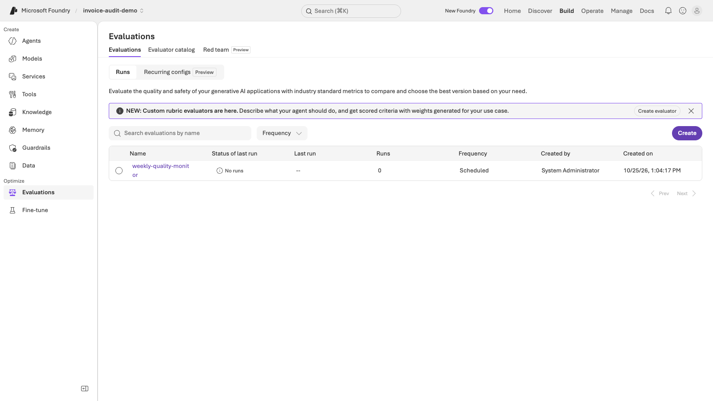

*Captura 9 — Evaluación recurrente "weekly-quality-monitor" ya creada y activa (pestaña Recurring configs).*

**Red team — cuidado con 2 botones "Configure" idénticos:** en Monitor → Overview hay dos tarjetas con botón "Configure" ("Evaluations" y "Scheduled red teaming run issues") que llevan **al mismo diálogo** "Monitor settings" (5 opciones: App Insights, Insights, Recurring evaluations, Scheduled red teaming runs, Evaluation Alerts).

**Lección real de esta sesión — el primer escaneo se atascó:** el primer red team (9 categorías de riesgo) quedó atascado 1h42m con 0 resultados y sin error. Lo cancelamos y creamos uno nuevo y más liviano (`invoice-audit-security-scan-quick`, solo 2 categorías, 3 preguntas c/u) — ese sí avanzó con normalidad y es el que dio el resultado real (75%/3%) mostrado arriba.

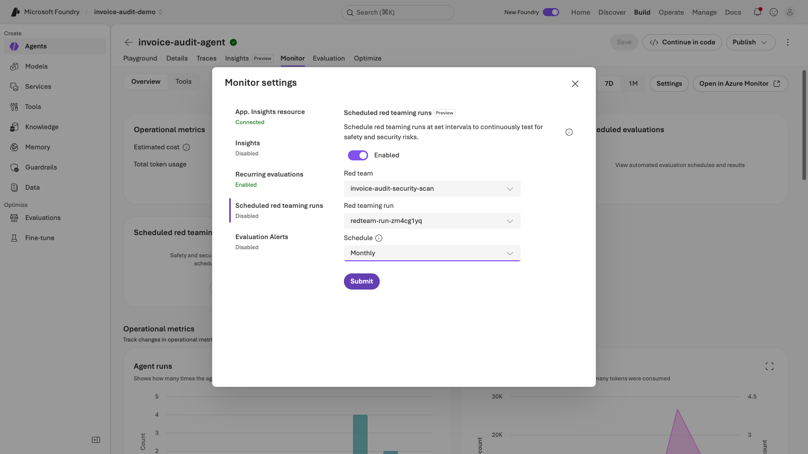

*Captura 16 — "Scheduled red teaming runs" activado dentro de Monitor settings: reutiliza un red team + run existentes y les aplica una cadencia (Hourly/Daily/Weekly/Monthly).*

⚠️ *Pendiente: la programación mensual configurada apunta todavía al red team cancelado — hay que repuntarla a `invoice-audit-security-scan-quick` antes de la demo final.*

# Sección 5 — Tune: Evaluator y mejora continua

> **Objetivo de esta sección**
> Mostrar que la calidad del agente no se mide 'a ojo' — existe una rúbrica medible, repetible y auditable que certifica si el agente cumple su propósito.

## Navegación — Catálogo de evaluadores

https://ai.azure.com/nextgen/r/3eUZlgMRTK6RlV-UO9QbxQ,rg-invoice-audit-demo,,invoice-audit-foundry2,invoice-audit-demo/build/evaluations/catalog/contract-policy-evidence-compliance/1?tid=e00660b6-957d-4851-a2b1-26d94d7527cd

**Qué mostrar en pantalla (evaluador)**

- Evaluador custom: "Contract-Policy-Evidence Compliance" (tipo Rubric, auto-generado por IA a partir de una instrucción en lenguaje natural).
- Dimensiones con peso: line_item_audit_correctness (peso 9) — ¿el agente asignó correctamente la disposición de facturación según la evidencia? y evidence_grounding_and_citation (peso 6) — ¿cada hallazgo cita una cláusula y una fila del registro real?

*Nota importante: como este ambiente fue recreado limpio (nueva cuenta Foundry), el evaluador custom "Contract-Policy-Evidence Compliance" TODAVÍA NO EXISTE aquí — debe crearse manualmente siguiendo el paso documentado en el repo (~5 min) antes de poder mostrar esta sección. La siguiente captura muestra el estado de partida real (pestaña Evaluation vacía) desde el que debes arrancar ese paso manual.*

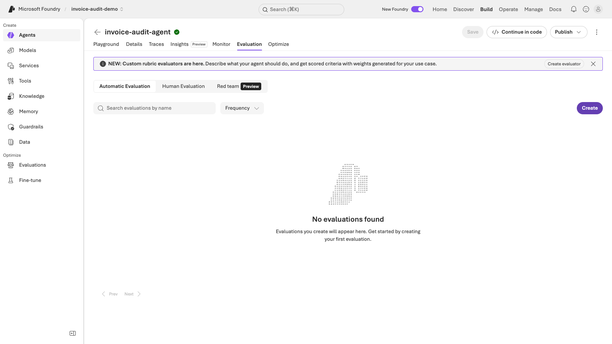

*Captura 6 — Estado de partida: pestaña Evaluation del agente antes de crear el evaluador custom ("No evaluations found").*

## Navegación — Resultados de la evaluación

https://ai.azure.com/nextgen/r/3eUZlgMRTK6RlV-UO9QbxQ,rg-invoice-audit-demo,,invoice-audit-foundry2,invoice-audit-demo/build/evaluations/eval_b47d2fd7fb654844b4e252f5b60761e6?tid=e00660b6-957d-4851-a2b1-26d94d7527cd

*Nota: este ID de evaluación (eval_b47d2fd7...) corresponde al ambiente manual original y ya no existe aquí. Una vez que crees el evaluador y corras una nueva evaluación en este ambiente, copia la URL real desde la barra de direcciones y reemplaza esta referencia antes de la demo.*

**Qué mostrar en pantalla (resultados)**

- Evaluación "invoice-audit-evaluation-run-1" ejecutada sobre 3 trazas reales (Application Insights traces) — no datos sintéticos.
- Score global: 67% (28/42) combinando 7 evaluadores (seguridad + calidad + el evaluador custom).
- Score del evaluador custom "contract-policy-evidence-compliance": 100% (3/3) — las 3 respuestas del agente citaron evidencia real y asignaron la disposición correcta.
- Abre el detalle de una fila para mostrar el razonamiento del juez (modelo gpt-5.4) explicando por qué aprobó o rechazó cada dimensión.
**Mensaje de valor para el cliente**

*"Esto no es un checklist manual una vez al trimestre. Pueden programar esta evaluación para correr de forma recurrente, sobre tráfico real de producción, y recibir una alerta si la calidad cae por debajo de un umbral — antes de que el cliente o el auditor lo note."*

# Cierre sugerido

"Recorrimos el ciclo completo: construimos un agente con conocimiento empresarial real (Build), verificamos que cada respuesta es trazable y auditable (Observe vía Traces y Monitor), y certificamos su calidad con una rúbrica medible y repetible (Tune vía Evaluations). Todo dentro de la misma plataforma — Microsoft Foundry — sin herramientas adicionales, sin exportar datos a otro sistema."

## Resumen de URLs de navegación

- Playground / Build: https://ai.azure.com/nextgen/r/3eUZlgMRTK6RlV-UO9QbxQ,rg-invoice-audit-demo,,invoice-audit-foundry2,invoice-audit-demo/build/agents/invoice-audit-agent/build?tid=e00660b6-957d-4851-a2b1-26d94d7527cd
- Traces: https://ai.azure.com/nextgen/r/3eUZlgMRTK6RlV-UO9QbxQ,rg-invoice-audit-demo,,invoice-audit-foundry2,invoice-audit-demo/build/agents/invoice-audit-agent/traces?tid=e00660b6-957d-4851-a2b1-26d94d7527cd
- Monitor: https://ai.azure.com/nextgen/r/3eUZlgMRTK6RlV-UO9QbxQ,rg-invoice-audit-demo,,invoice-audit-foundry2,invoice-audit-demo/build/agents/invoice-audit-agent/monitor/overview?tid=e00660b6-957d-4851-a2b1-26d94d7527cd
- Knowledge: https://ai.azure.com/nextgen/r/3eUZlgMRTK6RlV-UO9QbxQ,rg-invoice-audit-demo,,invoice-audit-foundry2,invoice-audit-demo/build/knowledge?tid=e00660b6-957d-4851-a2b1-26d94d7527cd
- Evaluator catalog: https://ai.azure.com/nextgen/r/3eUZlgMRTK6RlV-UO9QbxQ,rg-invoice-audit-demo,,invoice-audit-foundry2,invoice-audit-demo/build/evaluations/catalog/contract-policy-evidence-compliance/1?tid=e00660b6-957d-4851-a2b1-26d94d7527cd
- Resultados de evaluación: https://ai.azure.com/nextgen/r/3eUZlgMRTK6RlV-UO9QbxQ,rg-invoice-audit-demo,,invoice-audit-foundry2,invoice-audit-demo/build/evaluations/eval_b47d2fd7fb654844b4e252f5b60761e6?tid=e00660b6-957d-4851-a2b1-26d94d7527cd

# Capítulo 3 — Seguridad: identidad de agentes y gobierno

**Objetivo de esta sección**

Mostrar cómo gobernar y asegurar agentes de IA en producción: visibilidad de identidad (Microsoft Entra Agent ID), detección automática de riesgos reales (Microsoft Defender for Cloud), y una acción de contención auditable — todo sobre el MISMO agente que construimos en el Capítulo 2 (invoice-audit-agent, cuenta invoice-audit-foundry2). No es un ambiente aparte: es la misma demo, vista desde la perspectiva de seguridad y gobierno.

**Prerrequisito (ya habilitado en este tenant, sin pasos adicionales)**

- Microsoft Defender for Cloud — plan "AI" (Standard) ya está activo en esta suscripción (trial de 30 días). Se puede habilitar en cualquier tenant con: az security pricing create --name AI --tier Standard.
- Microsoft Entra Agent ID (registro de identidades de agente) está disponible de forma nativa en Entra ID — no requiere activación ni licencia adicional más allá de Entra ID estándar.

## Sección 1 — Identidad de agentes (Microsoft Entra Agent ID)

**Navegación**

- Portal: entra.microsoft.com → Entra ID → Agents
https://entra.microsoft.com/#view/Microsoft_AAD_RegisteredApps/AllAgents.MenuView/~/overview

**Qué mostrar en pantalla**

- Panel "Overview": 8 identidades de agente detectadas en el tenant, todas asociadas a nuestro ambiente (invoice-audit-foundry / invoice-audit-foundry2), con sus "Agent blueprints" (plantillas padre) listados a la derecha.

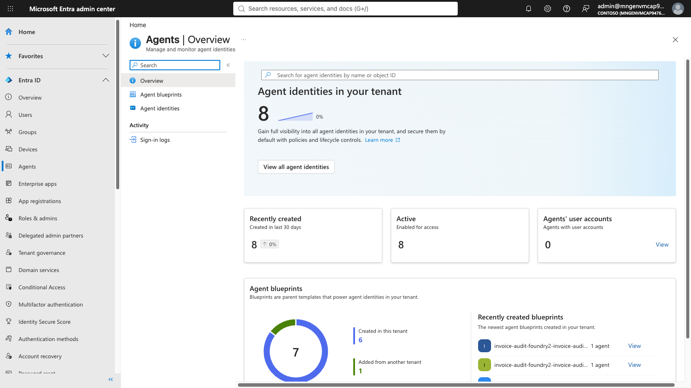

*Captura 1 — Entra ID Agents Overview: 8 identidades de agente activas, blueprints recientes mostrando nuestro propio ambiente.*

- Clic en "View all agent identities" → lista completa con Status "Active" y fecha de creación (10/23/26, el mismo día del deploy del Capítulo 2).
- Clic en una identidad específica (invoice-audit-foundry2/projects/invoice-audit-demo) → detalle de la Enterprise Application asociada: Application ID, Object ID, Conditional Access, Permissions, Sign-in logs.

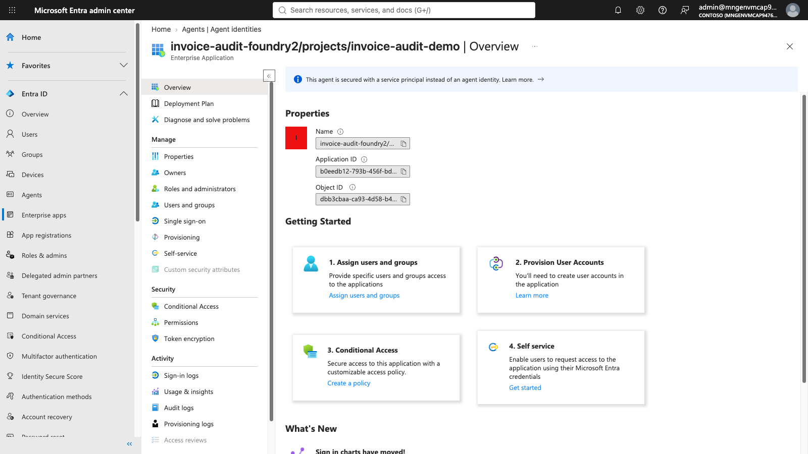

*Captura 2 — Detalle de la identidad del agente en Entra ID: propiedades, Application ID/Object ID, y opciones de gobierno (Conditional Access, Roles, Permissions).*

**Mensaje de valor para el cliente**

"Cada agente de IA que se crea en Foundry tiene una identidad gobernable en Entra ID — igual que cualquier aplicación empresarial. Pueden ver, auditar y aplicar Conditional Access sobre estas identidades, sin importar cuántos agentes desplieguen en su organización. No hay agentes 'fantasma' o fuera del radar de identidad."

## Sección 2 — Hallazgo real de seguridad (Microsoft Defender for Cloud)

**Navegación**

- Portal: portal.azure.com → Microsoft Defender for Cloud → Inventory → invoice-audit-foundry2
https://portal.azure.com/#view/Microsoft_Azure_Security/SecurityMenuBlade/~/25

**Qué mostrar en pantalla**

- 2 recomendaciones activas "Unhealthy" sobre nuestro propio recurso, detectadas automáticamente por Defender sin ninguna configuración manual: "Microsoft Foundry resources should use Azure Private Link" y "Microsoft Foundry resources should restrict network access".

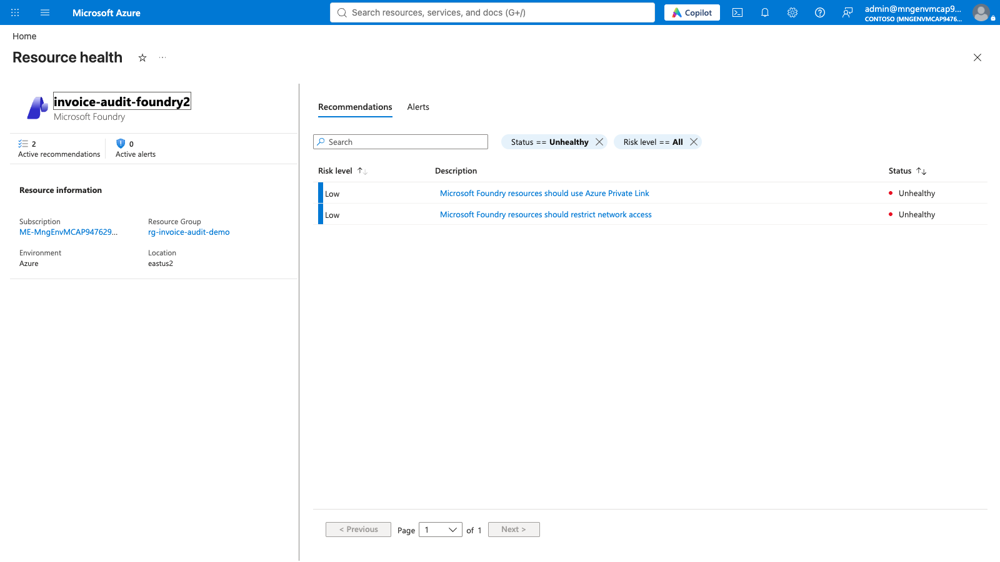

*Captura 3 — Resource health de invoice-audit-foundry2: 2 recomendaciones Unhealthy reales, detectadas automáticamente por Defender for Cloud.*

- Clic en "should restrict network access" → detalle completo: descripción, Attack Paths (0 por ahora), tácticas MITRE ATT&CK asociadas (Lateral Movement, Exploitation of Remote Services, Lateral Tool Transfer, Remote Services), y plan de remediación (Quick Fix automático + instrucciones manuales paso a paso).

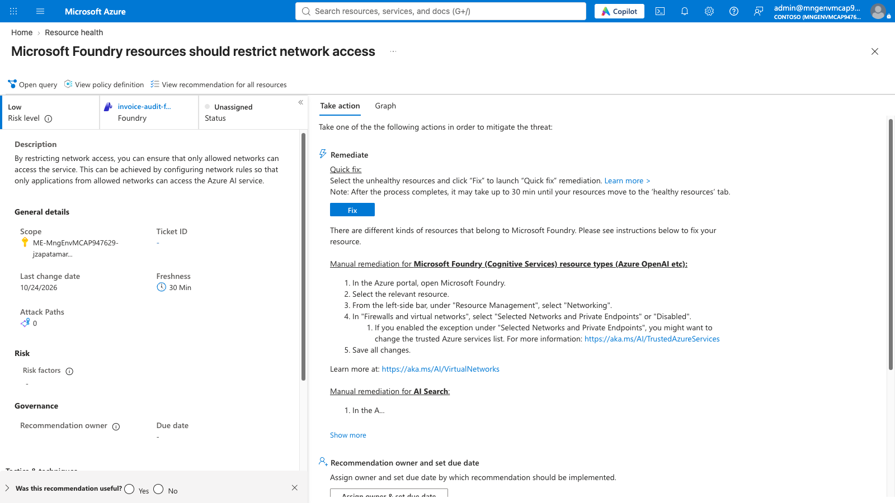

*Captura 4 — Detalle de la recomendación: descripción, plan de remediación (Quick Fix), y tácticas MITRE ATT&CK que este hallazgo habilitaría si se combinara con otros.*

**Mensaje de valor para el cliente**

"Esto no es un recurso de ejemplo — es el agente real que construimos juntos en el Capítulo 2. Defender lo detectó automáticamente apenas se desplegó, sin que nadie lo configurara manualmente ni corriera un escaneo a propósito."

## Sección 3 — Mapa de relaciones / Attack Path Analysis

**Navegación**

- Portal: Microsoft Defender for Cloud → Attack path analysis
https://portal.azure.com/#view/Microsoft_Azure_Security/SecurityMenuBlade/~/AttackPaths

**Qué mostrar en pantalla**

- "No attack paths found" (0 total, 0 recursos afectados). Es un resultado honesto y esperado: los hallazgos actuales (Sección 2) son de riesgo Low y aún no se combinan entre sí en una cadena explotable completa — pero Defender los sigue rastreando de forma proactiva, antes de que escalen.

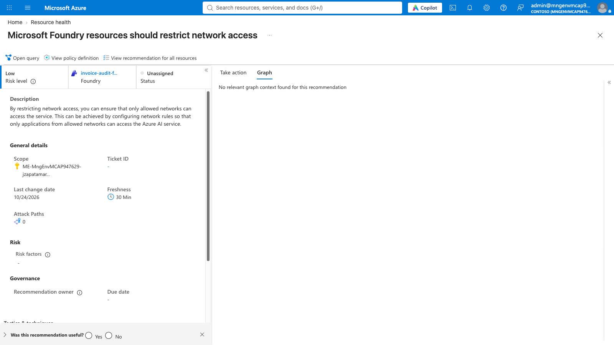

*Captura 5 — Attack path analysis: sin rutas de ataque activas hoy. La pestaña "Graph" dentro de la recomendación individual también muestra "No relevant graph context found" por el mismo motivo (ver nota abajo).*

*Nota de timing: el plan Defender for AI se activó hace poco más de 24 horas en este tenant. El motor de grafo de relaciones (el que construye el mapa completo de blast radius, similar al escenario original de Caldova con OpenClaw → storage account "internalpayments") puede tardar hasta 24-48h en indexar todas las relaciones entre recursos tras activarse. Si repites esta demo varios días después del deploy inicial, es probable que el grafo ya muestre relaciones completas (p. ej. agente → Search → Knowledge Base) incluso sin un hallazgo crítico que las dispare.*

**Mensaje de valor para el cliente**

"Defender no solo lista problemas sueltos — intenta conectar los puntos para ver si un atacante podría encadenarlos en una ruta real de compromiso. Hoy no hay una ruta completa, que es exactamente la postura que queremos, pero seguimos viendo y corrigiendo cada pieza individual antes de que se convierta en una."

## Sección 4 — Contención y auditoría

**Navegación**

- Misma recomendación ("should restrict network access") → sección "Recommendation owner and set due date" → botón "Assign owner & set due date".
**Qué mostrar en pantalla**

- Antes: Status = "Unassigned", sin owner ni due date (ver Captura 3/4).
- Asignar: owner = admin@mngenvmcap947629.onmicrosoft.com, remediation timeframe = fecha por defecto (2 semanas).
- Después: Status cambia a "On time", con Recommendation owner y Due date (11/7/2026) visibles en la sección "Governance" — este es el equivalente real y auditable de "Restrict App Execution + comentario de auditoría" del guion original de Caldova.

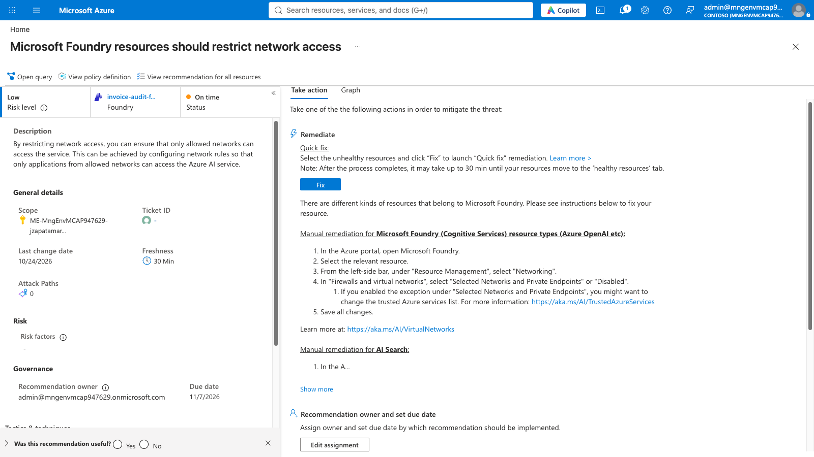

*Captura 6 — Después de la asignación: Status = "On time", Recommendation owner y Due date asignados en la sección Governance. Acción de contención real y auditable, sin romper la conectividad del agente.*

*⚠️ Nota importante de seguridad para quien ejecute esta demo: a propósito NO se deshabilitó el acceso de red pública real del recurso — eso rompería la conectividad del invoice-audit-agent (Playground, API, Evaluations) que se usa en el Capítulo 2 y que el usuario necesita seguir revisando. La acción de "asignar owner + due date" es el paso de gobierno/auditoría real y seguro de ejecutar en esta demo compartida. En un ambiente de producción real separado, el siguiente paso sería aplicar la remediación completa vía el botón "Fix" (Quick Fix) o manualmente — Networking → "Selected Networks and Private Endpoints" o "Disabled" — una vez validado que no interrumpe la operación.*

**Mensaje de valor para el cliente**

"La gobernanza de seguridad no es un evento único — es un ciclo: detectar, asignar dueño, fijar fecha, remediar, verificar. Aquí ven ese ciclo completo corriendo sobre su propio agente de producción, con trazabilidad total de quién es responsable y para cuándo."

# Cierre sugerido — Capítulo 3

"Recorrimos el otro lado de la moneda: no solo construimos y operamos un agente (Capítulo 2) — también lo gobernamos. Su identidad está registrada y es auditable en Entra ID. Su postura de seguridad se monitorea automáticamente en Defender for Cloud, con hallazgos reales, tácticas MITRE ATT&CK mapeadas, y una acción de contención con dueño y fecha — todo sin salir de las mismas herramientas de Microsoft que ya usan hoy, y sobre el mismo agente que acabamos de construir."

## Resumen de URLs de navegación — Capítulo 3

- Entra ID Agents (Overview): https://entra.microsoft.com/#view/Microsoft_AAD_RegisteredApps/AllAgents.MenuView/~/overview
- Entra ID Agent identities (lista completa): https://entra.microsoft.com/#view/Microsoft_AAD_RegisteredApps/AllAgents.MenuView/~/allAgentIds
- Defender for Cloud — Inventory: https://portal.azure.com/#view/Microsoft_Azure_Security/SecurityMenuBlade/~/25
- Defender for Cloud — Data and AI security: https://portal.azure.com/#view/Microsoft_Azure_Security/SecurityMenuBlade/~/AscInformationProtection
- Defender for Cloud — Attack path analysis: https://portal.azure.com/#view/Microsoft_Azure_Security/SecurityMenuBlade/~/AttackPaths
- Defender for Cloud — Cloud Security Explorer: https://portal.azure.com/#view/Microsoft_Azure_Security/SecurityMenuBlade/~/SecurityGraph